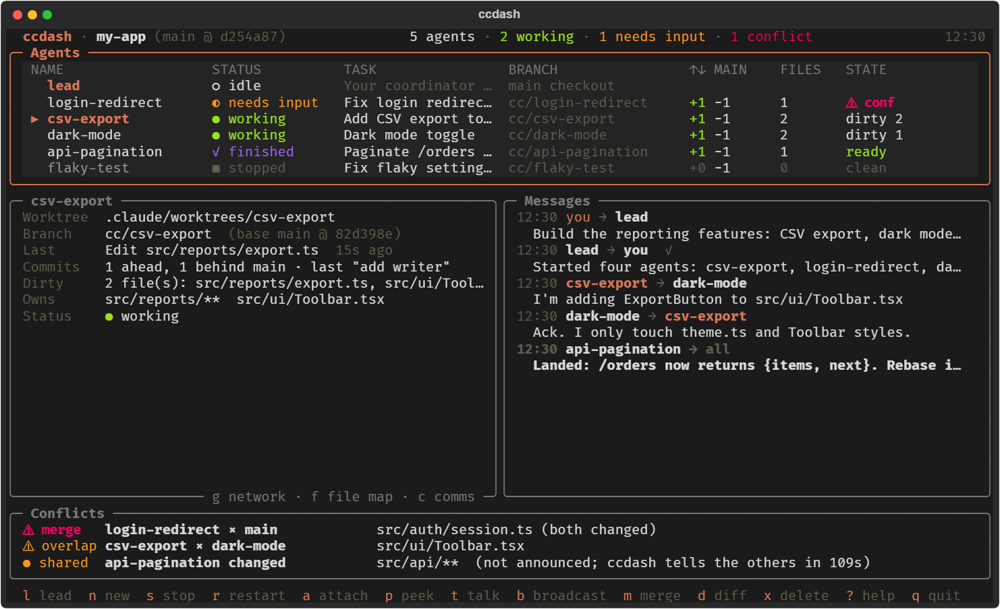
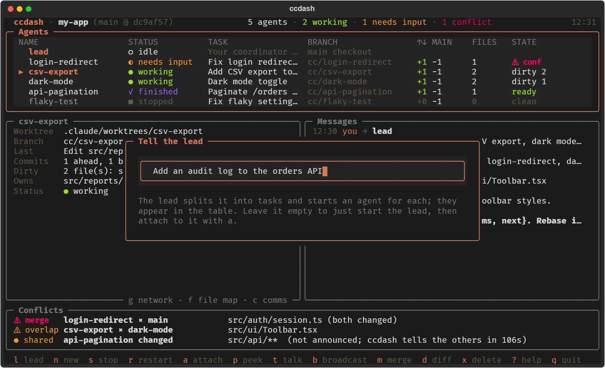
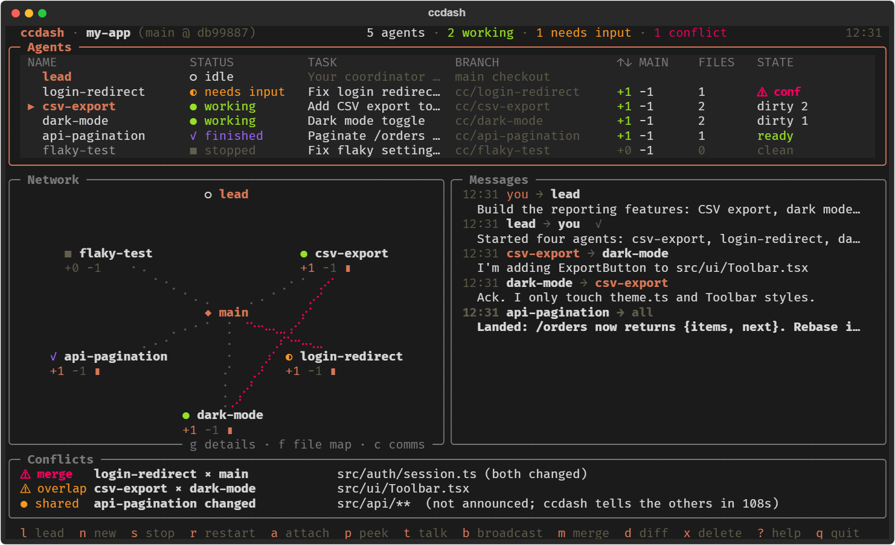
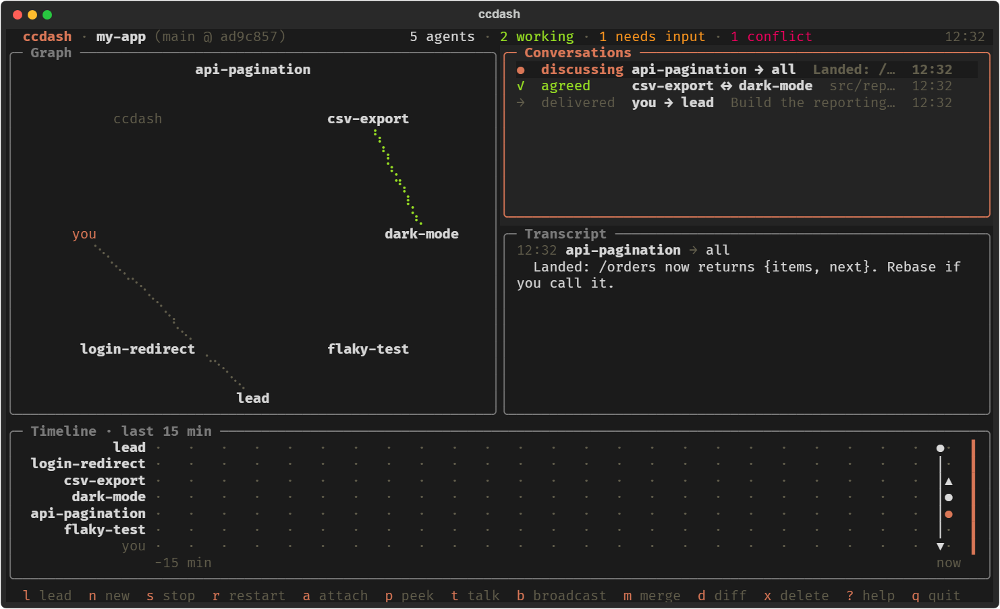
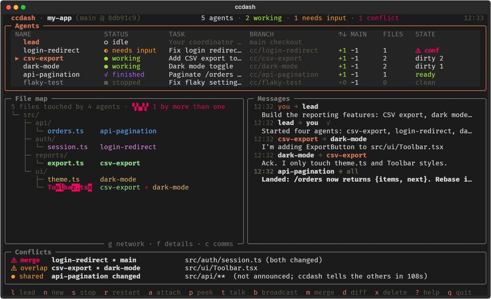
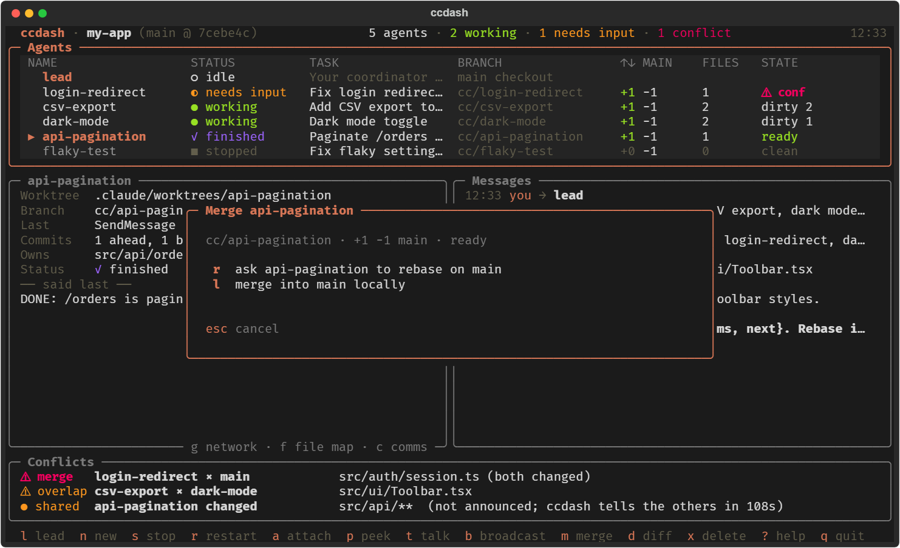

# ccdash

**Run a team of Claude Code agents on one repository, from one terminal.**

Open `cc` in a git repo and say what you want built. A lead agent splits the request into tasks and starts a Claude Code agent for each one, every agent in its own git worktree and branch. The dashboard shows what each agent is doing, who is talking to whom, where two of them are about to collide, and how far each branch is from merged.



Every agent is the normal `claude` CLI you already use, under your login. Your MCP servers, skills, `CLAUDE.md` and settings load exactly as in a session you start by hand. ccdash adds its hooks and a short coordination prompt, nothing else.

## Why

Starting five Claude Code sessions in parallel is easy. Keeping track of them is not:

- Which one is waiting for a permission answer while you look at another?
- Are two of them editing the same file right now?
- Which branch can be merged, and which one will conflict when you try?

ccdash answers these on one screen, and it keeps the agents alive when you close the terminal.

## What you get

### Say what you want, the lead starts the agents

Press `l` and type one line. The lead is a Claude Code session of its own that turns your request into tasks and starts an agent for each. The agents appear in the table as they start; the lead's answer shows up in the Messages panel.



You can still start a single agent by hand with `n`, or from the shell with `cc "Add CSV export to the reports page"`.

### One table that is always current

Status comes from Claude Code's own hooks, not from guessing at terminal output:

| Status | Meaning |
| --- | --- |
| `● working` | busy; the details panel shows the tool call it is on |
| `◐ needs input` | a permission dialog is open; the row moves to the top and pulses |
| `○ idle` / `✓ finished` | its turn is over; finished means it reported `DONE` or ended the turn with a commit |
| `■ stopped` / `✕ crashed` | not running; the worktree and branch are untouched |

Select an agent with the arrow keys. The details panel shows what it said last, so you can read an answer without leaving the dashboard. `p` shows its live screen, `a` puts you inside its session, and F12 brings you back.

### See how they talk to each other

Agents coordinate with Claude Code's `SendMessage`. Press `g` for the network view: every agent hangs off the default branch, messages are lines between them, and a red line means the two are in each other's way.



Press `c` for the full conversation view: who talked to whom, whether they agreed, the transcript, and a timeline of the last 15 minutes.



### See collisions before they cost you

The Conflicts panel fills in while the agents work:

| Row | Trigger |
| --- | --- |
| `⚠ merge` (red) | git predicts that a branch will conflict with the default branch or with another agent's branch. Nothing is merged to find this out. |
| `⚠ overlap` (yellow) | two agents edited or claimed the same file. It shows as soon as the edit happens, before anything is committed. |
| `● shared` | an agent changed a file you marked as a shared interface. If it did not tell the others, ccdash does. |
| `· stale` (grey) | a branch is far behind the default branch |

Press `f` for the file map: the files being changed, each in the color of the agent that changed it. A file with two agents in it is red and striped.



### Merge when a branch is ready

`m` opens the merge menu for the selected agent. It offers only what is possible right now and says why something is missing.



- **Ask the agent to rebase.** The right choice for conflicts: the agent knows its own changes.
- **Merge locally.** A no-fast-forward merge in your main checkout. If you configured a test command, it runs on the merged tree first. On a conflict or a failed test the merge is aborted and your branch is exactly as it was.
- **Open a pull request** through `gh`, if you have it.

After a merge, every other running agent is told what landed and whether its own branch now conflicts.

### Nothing is lost

- Closing the dashboard, or the whole terminal, stops no agent. The next `cc` shows them again.
- Stopping an agent keeps its worktree, its branch and its conversation; `r` resumes it.
- Deleting an agent with unmerged or uncommitted work asks you to type its name.
- ccdash never force-pushes, never rewrites your default branch, and never merges without a key press from you.

## Quick start

**You need**

- Windows 10 (1809 or later) or Windows 11, with PowerShell in Windows Terminal or the VS Code terminal
- [Claude Code](https://code.claude.com), installed and logged in
- Python 3.11 or later (python.org or uv-managed, not the Microsoft Store build) and [uv](https://docs.astral.sh/uv/)
- git; version 2.38 or later gives the best conflict prediction
- optional: `gh` for pull requests

**Install**

```powershell
git clone https://github.com/Baumwollboebele/ccdash.git
cd ccdash
uv tool install --editable .
```

This gives you the commands `cc` and `ccdash`. To try it without installing, run `uv sync` and call `.venv\Scripts\cc.exe` instead of `cc`.

**Run**

```powershell
cd C:\path\to\your\repo
cc
```

Before the first agent, the repository must be trusted in Claude Code: run `claude` there once and accept the trust dialog.

## Your first ten minutes

1. **Open the dashboard.** `cc` inside your repository.
2. **Tell the lead what you want.** Press `l`, type for example `Add a CHANGELOG.md and a CONTRIBUTING.md`, press Enter. The lead appears as the first row, then one agent per task below it.
3. **Read the answer.** The lead's reply appears in Messages as `lead → you`. Select any agent with `↑` `↓` to see what it is doing and what it said last.
4. **Answer a prompt.** If a row turns to `◐ needs input`, select it and press `a`. You are now inside that agent's own Claude Code session. Answer, then press **F12** to come back.
5. **Look around.** `g` shows the network, `c` the conversations, `f` the file map. The same key brings the details back.
6. **Merge.** When an agent's state says `ready`, select it, press `m`, then `l` for a local merge.
7. **Leave.** `q` quits the dashboard. The agents keep working; `cc` shows them again.

## Keys

| Key | Action |
| --- | --- |
| `↑` `↓`, `Tab` | select an agent (a click works too) |
| `l` | tell the lead what you want; it starts the agents |
| `n` | start one agent by hand |
| `a` / `Enter` | attach to the agent's session; F12 comes back |
| `p` | peek: the agent's live screen in the details panel |
| `t` / `b` | send one line to the selected agent / to all of them |
| `s` / `r` | stop / resume |
| `m` | merge menu: rebase, merge locally, open a pull request |
| `d` | diff of the agent's branch in a pager |
| `x` | delete the agent's worktree and branch |
| `g` / `f` / `c` | network view / file map / conversations |
| `/` | filter by name, status or file |
| `o` | claim paths for the selected agent |
| `?` | all keys |
| `q` | quit; agents keep running |

## From the shell

| Command | What it does |
| --- | --- |
| `cc` | open the dashboard |
| `cc lead "work on feature xyz"` | give the lead a request without opening the dashboard |
| `cc "Fix the login redirect"` | start one agent for a task (`cc new "…" --name fix-login` to name it) |
| `cc ls` | list agents with status, branch and state (`--json` for scripts) |
| `cc peek <name>` | print an agent's current screen |
| `cc send <name> "…"` / `cc broadcast "…"` | type one line into an agent / into all |
| `cc attach <name>` | take over an agent's terminal |
| `cc stop <name>` / `cc restart <name>` / `cc rm <name>` | stop, resume, delete |

## Configuration

Optional. Put a `.ccdash.toml` in the repository root; `~/.config/ccdash/config.toml` overrides it for you personally.

```toml
default_branch = "main"            # detected from origin if omitted
setup  = "npm ci"                  # run once in each new worktree
test   = "npm test"                # must pass before a local merge is committed
shared = ["src/api/**", "migrations/**", "package.json"]   # changes here are announced to all agents
max_agents = 6                     # agents running at once (the lead does not count)

# Extras, all off by default
# guard   = "warn"                 # warn | block: stop an agent from editing files another agent holds
# open_in = "wt"                   # attach opens a new Windows Terminal tab
# repos   = ["C:/src/api-server"]  # more repositories in one dashboard; R switches (user config)
# runner  = "bg"                   # run agents as Claude Code background sessions (experimental)
```

Gitignored files an agent needs, such as `.env`, are copied into each new worktree when you list them in `.worktreeinclude`, the same file Claude Code uses.

## How it works

There is no server. ccdash is three things working on one state directory inside `.git`:

```text
               ┌──────────────────────────────┐
               │       ccdash dashboard       │
               └──▲───────────▲────────────▲──┘
start, stop,      │    events │     status │
attach            │           │            │
┌─────────────────┴┐ ┌────────┴─────────┐ ┌┴─────────────────┐
│ one host per     │ │ state directory  │ │ git              │
│ agent, owns its  │ │ .git/ccdash/     │ │ worktrees,       │
│ terminal         │ │ events, registry │ │ branches         │
└────────┬─────────┘ └────────▲─────────┘ └────────▲─────────┘
         │ runs               │ hooks report       │ commits
         │                    │ every step         │
┌────────▼────────────────────┴────────────────────┴─────────┐
│ agents: your claude CLI, each in its own worktree          │
└────────────────────────────────────────────────────────────┘
```

- **A host per agent** keeps the interactive `claude` alive in its own pseudo-terminal, detached from the terminal you started it from.
- **Claude Code hooks** report every step (prompt, tool call, permission request, stop) into an event log. That log is the only source of status; terminal output is shown, never parsed.
- **git** supplies ahead/behind, changed files and the merge predictions (`git merge-tree`, which touches no worktree).

The design, the decisions behind it and what was verified against the real Claude Code are in [`docs/PLAN.md`](docs/PLAN.md) and [`docs/findings.md`](docs/findings.md).

## Status

ccdash is young. What you can rely on, and what you cannot yet:

- **Developed and used on native Windows.** A tmux backend for macOS, Linux and WSL exists in the code but has not been run yet.
- **Verified with the real Claude Code:** starting agents in worktrees, live status from hooks, messages between agents, stop and resume, and a first working session with the lead.
- **Covered by tests against a scripted stand-in only:** guard mode, the background-session runner, pull requests through `gh`, and the rule that lets the lead start agents without a permission prompt. [`docs/NEXT.md`](docs/NEXT.md) lists the checks still to do, in order.
- **F12 to leave an attached session is new** and tested as a key sequence, not yet on every terminal. The fallback is the key that types the detach character: `Ctrl+]` on a US keyboard, `Ctrl++` on a German one. The first attach tells you which keys apply to your keyboard.
- **Cost.** Every agent is a full Claude Code session on your subscription. Several in parallel use your limits faster; `max_agents` caps how many run at once.

## Development

```powershell
uv sync
.venv\Scripts\python.exe -m pytest -q
```

The tests never call the real Claude Code or GitHub: a fake `claude` and a fake `gh` in `tests/` play their parts against real git repositories in temp directories. The full suite takes several minutes because it starts real agent hosts.

The screenshots on this page are generated, not hand-made:

```powershell
.venv\Scripts\python.exe scripts\screenshot.py docs\screenshots\main.svg
```
